# Mapa de atores — Atendimento ao Seguro-Desemprego pela URA da CAIXA

**Aluna:** Flavia Rios · **Exercício 2.1** · IDP-TD 2026
**Serviço:** Atendimento ao Seguro-Desemprego pela URA da Caixa Econômica Federal (canal telefônico; órgãos: CAIXA e Ministério do Trabalho e Emprego)
**Formato escolhido (Rodada 9):** diagrama mermaid, tabela de atores e matriz RACI complementar.
**Base:** decisões tomadas na sessão grill-me (`C_grill_transcript.md`) e evidências de `B_relatorio_assistente_v3.md`. Os códigos [C##] remetem à base de evidências da v3.

---

## 1. Regras de modelagem (decididas na entrevista)

**Fronteira (Rodada 1):** o mapa cobre o **episódio de resolução**: da necessidade que motiva a ligação à URA da CAIXA ("minha parcela não caiu") até a resolução, o encaminhamento definitivo ou o abandono. O ciclo completo do benefício não faz parte do mapa. O recorte é o **trabalhador formal** (Rodada 8).

**Camadas (Rodadas 2, 7 e 8):** o critério é a **função concreta no episódio**, e não a importância institucional.

| Camada | Quem entra |
|---|---|
| **Mapa principal** | Atores humanos ou institucionais e nós técnicos que integram a prestação habitual dos canais usados no episódio, mesmo quando atuam nos bastidores |
| **Fluxos de exceção** | Atores acionados em situações específicas de correção, contestação, recuperação de acesso ou resolução jurídica |
| **Círculo externo** | Atores de normatização, regulação, fiscalização e governança estrutural, sem participação operacional na resolução individual |
| **Fora do mapa** | Atores de modalidades ou processos que ultrapassam a fronteira |

**Sistemas (Rodadas 3 e 4):** modelo híbrido. Um sistema vira **nó sociotécnico** somente se (1) participa do episódio de resolução **e** (2) representa uma etapa autônoma da jornada. Caso contrário, aparece como **rótulo** de uma relação. Os nós técnicos não têm interesses nem resistências: a ficha deles traz função, organização responsável e possíveis falhas.

**Granularidade (Rodadas 5 e 6):** grupos da mesma instituição com responsabilidades, incentivos ou capacidades diferentes são representados separadamente. Segmentos do cidadão viram subgrupos quando enfrentam uma barreira que exige adaptação do atendimento, mesmo sem estatística de uso.

**Tipos de relação (Rodada 9):** **atendimento** (inclui orientação), **encaminhamento** (inclui reclamação e escalonamento), **dados**, **financeira** e **governança** (inclui norma e controle).

**Grau de evidência (Rodadas 6 e 9):** seta contínua indica relação documentada. Seta tracejada indica relação hipotética ou ainda não confirmada. O tracejado indica grau de evidência, e não um sexto tipo de relação.

**Lacuna de coordenação (Rodada 10):** não foi identificado documentalmente um responsável pelo episódio completo. A ausência aparece no próprio diagrama, como lacuna, e não como ator fictício.

---

## 2. Diagrama

```mermaid
flowchart TB
  LAC["⚠ Coordenação do episódio completo: NÃO IDENTIFICADA (lacuna documental, não é um ator)"]

  subgraph EXT["Círculo externo — governança"]
    TCU["TCU"]
    CODEFAT["CODEFAT (tripartite)"]
    CGU["CGU"]
    BCB["BCB / CMN"]
    FISC["MTE — gestão e fiscalização contratual"]
  end

  subgraph PRINC["Mapa principal — episódio de resolução"]
    subgraph CID["Cidadão"]
      TIT(["Trabalhador titular (formal)"])
      RUR(["Usuários rurais e com baixo letramento digital"])
      PCD(["Pessoas surdas ou com deficiência auditiva ou de fala"])
      FAM(["Familiares e pessoas de apoio (condicional)"])
    end
    URA{{"URA da CAIXA (nó central)"}}
    C158{{"Central 158"}}
    CTPS{{"CTPS Digital / Emprega Brasil"}}
    SSD[("Sistema do Seguro-Desemprego")]
    CXCID["CAIXA — atendimento CAIXA Cidadão"]
    CXPAG["CAIXA — gestão de pagamentos"]
    CXSAC["CAIXA — SAC e Ouvidoria"]
    CXREDE["CAIXA — rede presencial (agências, lotéricas, correspondentes)"]
    MTEB["MTE — gestão do benefício"]
    SRTE["MTE — SRTE"]
    MTEOUV["MTE — Ouvidoria"]
    INSS["INSS — execução do Contact Center 158 (TED)"]
    OP158["Operadores do Contact Center 158"]
    SINE["Sine estadual/municipal"]
    FORN["Fornecedores terceirizados potenciais (condicional)"]
  end

  subgraph EXC["Fluxos de exceção — correção na origem, acesso e via jurídica"]
    EMP["Empregador / RH"]
    RFB["Receita Federal"]
    BANCO["Banco recebedor"]
    DTP["Dataprev — organização"]
    MGI["MGI — governança do gov.br"]
    JUD["Judiciário"]
    MP["Ministério Público"]
    DEF["Defensorias Públicas"]
  end

  %% Lacuna: ligada ao cidadão sem seta, porque não há transferência automática do caso
  LAC -.- TIT

  %% Entrada no episódio
  TIT -->|"atendimento"| URA
  RUR -.->|"atendimento (barreira de conectividade e compreensão)"| URA
  PCD -.->|"atendimento (barreira: canal só sonoro)"| URA
  FAM -.->|"atendimento (tentativa em nome do titular)"| URA

  %% Bastidores da CAIXA
  CXCID -->|"atendimento: opera a URA"| URA
  URA -->|"dados: situação de parcelas e pagamentos"| CXPAG
  URA -.->|"encaminhamento: transbordo a atendente"| CXCID
  TIT -->|"encaminhamento: reclamação"| CXSAC
  TIT -->|"atendimento: saque e consulta"| CXREDE
  FORN -.->|"governança: subcontratação possível, não comprovada"| CXCID

  %% MTE x CAIXA
  MTEB -->|"financeira: lotes de pagamento"| CXPAG
  CXPAG -->|"dados: retorno pago / não pago"| MTEB
  MTEB -->|"dados: habilitação e situação"| SSD

  %% Canais do MTE
  TIT -->|"atendimento: recontato"| C158
  OP158 -->|"atendimento"| C158
  INSS -->|"governança: execução do TED"| OP158
  C158 -.->|"encaminhamento"| SINE
  C158 -.->|"encaminhamento"| SRTE
  TIT -->|"atendimento (login gov.br)"| CTPS
  CTPS -->|"dados"| SSD
  SINE -->|"dados: usa o sistema"| SSD
  TIT -->|"encaminhamento: reclamação"| MTEOUV

  %% Fluxos de exceção
  EMP -->|"dados (Empregador Web / eSocial)"| SSD
  RFB -.->|"dados: CPF de origem"| SSD
  DTP -->|"dados: operação e sustentação"| SSD
  CXPAG -->|"financeira: crédito em outra instituição"| BANCO
  MGI -.->|"dados: autenticação gov.br"| CTPS
  TIT -.->|"encaminhamento: assistência jurídica"| DEF
  TIT -.->|"encaminhamento: representação"| MP
  DEF -.->|"encaminhamento: ação judicial"| JUD

  %% Círculo externo
  CODEFAT -->|"governança: normas"| MTEB
  TCU -->|"governança: fiscalização"| MTEB
  CGU -->|"governança: supervisão"| MTEOUV
  BCB -->|"governança: regulação bancária"| CXSAC
  FISC -->|"financeira: medição, ateste e remuneração da URA — Contrato 11/2021"| CXCID
  FISC -->|"financeira: TED do Contact Center"| INSS

  classDef tec fill:#e8f0fe,stroke:#3b6fd8,stroke-width:2px
  classDef cond stroke-dasharray: 5 5
  classDef lac fill:#fff4e5,stroke:#d9822b,stroke-width:2px,stroke-dasharray: 6 4
  class URA,C158,CTPS,SSD tec
  class FAM,FORN cond
  class LAC lac
```

**Como ler o diagrama:**
- Hexágonos e o cilindro são **nós sociotécnicos**.
- Retângulos são **organizações ou grupos funcionais**.
- Formas arredondadas são **pessoas**.
- Bordas tracejadas marcam **atores condicionais**.
- O quadro laranja no topo é a **lacuna de coordenação**. Ele não é um ator: indica que, na ausência de um coordenador documentado, é o cidadão que acaba carregando o esforço de circular entre os canais (Rodada 10).
- Os rótulos gov.br, CAIXA Tem, Empregador Web/eSocial e Portal de Demandas aparecem nas relações, e não como nós (Rodada 4).
- O Portal de Demandas CAIXA–MTE é a integração de bastidor por trás das setas entre as áreas da CAIXA e do MTE.

---

## 3. Tabela de atores

| # | Ator | Tipo | Camada | Papel no episódio | Interesse principal | Poder / dependência | Evidência (v3) | Rodada |
|---|---|---|---|---|---|---|---|---|
| 1 | Trabalhador titular (formal) | Pessoa (ator central) | Principal | Liga para a URA por causa da parcela, recontata, reclama, recorre | Receber a parcela com previsibilidade | Poder baixo; depende de dados e canais; carrega o ônus da fragmentação | [C01, C08, C13] | 1, 6, 10 |
| 2 | Usuários rurais e com baixo letramento digital | Subgrupo do cidadão | Principal | Acessam a URA sob restrições de rede e compreensão | Canal acessível e compreensível | Depende de cobertura móvel e linguagem simples | [C15] | 6 |
| 3 | Pessoas surdas ou com deficiência auditiva ou de fala | Subgrupo do cidadão | Principal | Barreira de uma URA exclusivamente sonora | Equivalência de acesso (Libras ou outro canal) | Direitos de acessibilidade; depende de implementação | [C17] | 6 |
| 4 | Familiares e pessoas de apoio | Ator auxiliar condicional | Principal (tracejado) | Tentam intermediar o contato em nome do titular | Resolver o caso do titular | Sem autoridade; barrados pela autenticação e pelo sigilo | Hipótese | 6 |
| 5 | CAIXA — atendimento CAIXA Cidadão | Grupo funcional | Principal | Opera a URA e o atendimento humano; recebe as reclamações de quem não recebeu | Atender e cumprir indicadores de atendimento | Não decide concessão; remunerado por ligação de URA no 11/2021 | [C01, C08, C09] | 5 |
| 6 | CAIXA — gestão de pagamentos | Grupo funcional | Principal | Efetiva créditos e devolve ao MTE o retorno pago/não pago | Pagar corretamente e controlar custos | Alto poder no pagamento; pode considerar uma operação concluída enquanto o cidadão não recebeu | [C03, C12] | 5 |
| 7 | CAIXA — SAC e Ouvidoria | Grupo funcional | Principal | Tratam reclamações sobre o serviço bancário | Corrigir falhas e cumprir a regulação | Supervisionados pelo BCB/CMN | [C09] | 5 |
| 8 | CAIXA — rede presencial | Grupo funcional | Principal | Saque e atendimento físico (agências, lotéricas, correspondentes) | Executar serviços presenciais | Não decide elegibilidade | [C03, C10] | 5 |
| 9 | MTE — gestão do benefício | Grupo funcional | Principal | Habilita, bloqueia ou desbloqueia, analisa recursos, gera lotes de pagamento | Concessão conforme a lei e controle de irregularidades | Alto poder decisório | [C11, C12] | 5 |
| 10 | MTE — SRTE | Unidade federal | Principal | Atendimento presencial federal | Resolver dentro da sua competência | Poder administrativo federal | [C13] | 5 |
| 11 | MTE — Ouvidoria | Grupo funcional | Principal | Recebe e encaminha manifestações individuais | Responder e acompanhar manifestações | Viés de canal digital (99,67%) | [C16] | 2, 5 |
| 12 | INSS — execução do Contact Center 158 | Instituição | Principal | Executa o 158 via TED com o MTE | Entregar o objeto do TED | Poder de execução; depende do MTE | [C04] | 4, 8 |
| 13 | Operadores do Contact Center 158 | Ator humano coletivo | Principal | Orientam e encaminham pelo 158 | Responder com qualidade sob pressão de fila | Autonomia limitada por sistemas e roteiros | [C04, C07, C14] | 4, 8 |
| 14 | Sine estadual/municipal | Ente federativo | Principal | Atendimento presencial; usa o sistema do Seguro-Desemprego | Resolver localmente | Poder local limitado por regras federais | [C06, C11] | 7 |
| 15 | Fornecedores terceirizados potenciais | Ator condicional | Principal (tracejado) | Possível atendimento acessório subcontratado | Cumprir o contrato | Subcontratação permitida, mas não comprovada | [C03, TR 4.6] | 5 |
| 16 | Empregador / RH | Organização | Exceção | Corrige dados trabalhistas na origem | Cumprir obrigações com pouco retrabalho | Poder sobre o dado de origem | [C05] | 7 |
| 17 | Receita Federal | Órgão | Exceção | Regulariza divergência de CPF | Integridade cadastral | Alto sobre o cadastro; nenhum sobre a concessão | [C06] | 7 |
| 18 | Banco recebedor | Instituição financeira | Exceção | Último trecho do crédito em conta de outro banco | Liquidação correta | Poder no crédito final | [C03] | 7 |
| 19 | Dataprev — organização | Empresa pública | Exceção | Corrige e reprocessa; opera e sustenta o sistema | Disponibilidade e integridade | Alto poder técnico; não define o benefício | [C18] | 7, 8 |
| 20 | MGI — governança do gov.br | Órgão | Exceção | Recuperação de acesso e autenticação | Segurança e acesso | Alto no login; não decide o benefício | [C13] | 8 |
| 21 | Judiciário | Poder | Exceção | Decide ações individuais | Legalidade e direitos | Alto em casos concretos | [C11, C12] | 2, 8 |
| 22 | Ministério Público | Órgão | Exceção | Atuação institucional quando cabível | Defesa de direitos | Alto em casos específicos | [C11] | 2, 8 |
| 23 | Defensorias Públicas | Órgão | Exceção | Assistência jurídica ao cidadão | Acesso à justiça | Atua quando acionada | [C11] | 2, 8 |
| 24 | MTE — gestão e fiscalização contratual | Grupo funcional | Círculo externo | Mede, atesta e remunera a CAIXA e o TED do 158 | Conformidade e controle de despesas | Alto poder contratual; define incentivos | [C01, C03, C04] | 5 |
| 25 | TCU | Órgão de controle | Círculo externo | Fiscaliza o serviço (Acórdão 1.621/2026) | Eficiência e legalidade | Alto poder de indução | [C05, C06] | 1, 2 |
| 26 | CODEFAT (tripartite) | Colegiado | Círculo externo | Define as normas do benefício | Governança do FAT | Alto poder normativo | [C11, C12] | 2 |
| 27 | CGU | Órgão de controle | Círculo externo | Supervisão e controle interno | Accountability | Poder de controle | [C16] | 2 |
| 28 | BCB / CMN | Reguladores | Círculo externo | Regulam o SAC e a Ouvidoria bancários | Conformidade financeira | Não decidem a concessão | [C09] | 2 |

### Nós sociotécnicos (ficha própria, sem interesses nem resistências — Rodada 3)

| Nó | Organização responsável | Função no episódio | Possíveis falhas | Rodada |
|---|---|---|---|---|
| URA da CAIXA (central) | CAIXA (atendimento CAIXA Cidadão); contratada pelo MTE no 11/2021 [C01] | Porta de entrada; informa a situação de parcelas e pagamentos | Menu não resolve, falta de transbordo a humano, barreira sonora; custeio no 07/2026 não identificado | 3, 4 |
| Central 158 | MTE; executada pelo INSS via TED [C04] | Canal alternativo de recontato no domínio do MTE | Fila e capacidade, encaminhamentos sem resolução, tarifação por celular a verificar | 4 |
| Sistema do Seguro-Desemprego | MTE; operado e sustentado pela Dataprev [C18] | Processa a situação do benefício consultada pelos canais | Mensagens genéricas, inconsistências de dados e reprocessamento | 3, 4, 7 |
| CTPS Digital / Emprega Brasil | MTE (acesso via gov.br/MGI) | Etapa autônoma de acompanhamento e esclarecimento | Indeferimento sem explicação, falha de login | 4 |

**Fora do mapa (Rodada 8):** pescadores artesanais e o INSS no legado do seguro-defeso. Eles pertencem a outra modalidade, fora do recorte do trabalhador formal.

---

## 4. Matriz RACI complementar — "Minha parcela não caiu" (Rodadas 9 e 10)

A frase do cidadão pode corresponder a problemas diferentes, por isso o **A** varia conforme a situação. Na Rodada 9, a aluna decidiu que C e I seriam definidos conforme a situação concreta. Depois da entrevista, ela aprovou o preenchimento abaixo, uma situação por linha, usando apenas atores do mapa. Ser consultado ou informado não pressupõe acesso irrestrito aos dados do cidadão.

| Situação identificada | R — Executa | A — Responde pelo resultado da etapa | C — Consultado | I — Informado |
|---|---|---|---|---|
| Parcela não liberada por problema de habilitação ou bloqueio administrativo | Área competente do MTE | **MTE — gestão do benefício** | Sine estadual/municipal e MTE — SRTE (atendimento presencial); Dataprev (sistema) | Trabalhador titular; CAIXA — gestão de pagamentos |
| Parcela liberada, mas pagamento não processado corretamente pela CAIXA | CAIXA — gestão de pagamentos | **CAIXA — gestão de pagamentos** | MTE — gestão do benefício (retorno pago/não pago) | Trabalhador titular; CAIXA — atendimento CAIXA Cidadão |
| Crédito enviado para outra instituição, mas não localizado na conta de destino | CAIXA e banco recebedor, conforme a etapa em que ocorreu a falha | **Responsável pela etapa comprovadamente falha**, a identificar após rastreamento | CAIXA — SAC e Ouvidoria | Trabalhador titular; MTE — gestão do benefício |
| Informação cadastral inconsistente | Responsável pelo dado de origem (Empregador/RH ou Receita Federal) | **Responsável pela correção cadastral**, conforme o tipo de inconsistência | MTE — gestão do benefício; Dataprev | Trabalhador titular |
| **Diagnóstico e coordenação da resolução interinstitucional do episódio completo** | **Não identificado** | **Não identificado** | — | — |

A última linha registra uma **lacuna de responsabilização documental**: as fontes examinadas não demonstram um coordenador do episódio, mas isso não prova que a coordenação inexista na prática (Rodada 10).

---

## 5. Hipóteses a validar

- Participação de familiares na URA e os limites de autenticação para eles (Rodada 6).
- Existência e alcance de atendimento acessível na URA para pessoas surdas (Rodada 6).
- Rotas efetivas de transbordo da URA para atendente e de encaminhamento do 158 para o Sine e a SRTE (Rodada 9).
- Subcontratação efetiva do atendimento da CAIXA (Rodada 5).
- Continuidade da remuneração por atendimento de URA após o Contrato 07/2026 (Rodada 5).
- Fragmentação da responsabilização pelo episódio completo (Rodadas 9 e 10).
